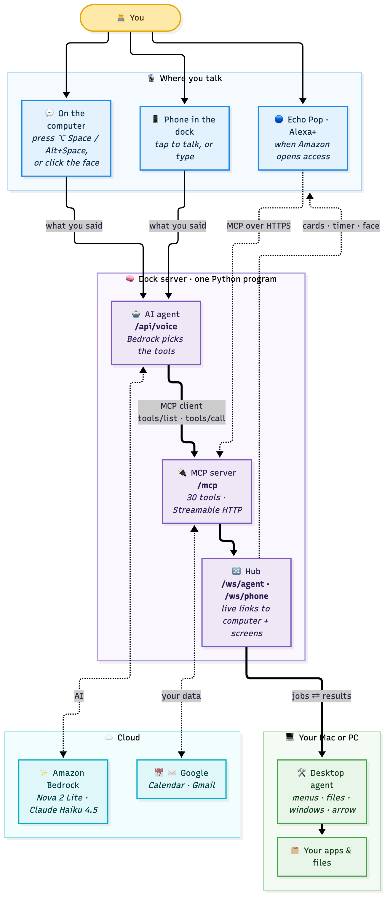

# EchoDock

Alexa+ for your desk. Ask out loud and Dock controls your computer and helps you inside the app you're using: it opens files and apps, arranges windows, says where a feature is and points at it on screen, and clicks it when you say "do it". A docked phone becomes a second screen and a shortcut pad for the app in front. An optional focus mode adds a timer and desk presence.

Built for the Amazon Developer Hackathon (Alexa+ track, October 2026).



## How it works

- **Dock MCP server** (`server/`): an MCP server on spec **2025-11-25** over **Streamable HTTP** (`/mcp`), built with the official MCP Python SDK. It exposes 30 tools, keeps state, calls Amazon Bedrock, and serves the phone web app.
- **Simulated Alexa+** (`server/dock_server/voice.py`): speech becomes text, a Bedrock model picks Dock's tools, and the server calls them through its own `/mcp` endpoint, the same way Alexa+ would as an MCP client.
- **Desktop agent** (`agent/`): runs on the computer and does the work. It connects out to the server over WebSocket, reads menus through the macOS Accessibility API (UI Automation on Windows), draws the on-screen pointer, and provides the menu bar app, talk key (⌥ Space) and local speech-to-text (Whisper).
- **Phone web app** (`server/static/`): plain HTML/JS with no build step. It shows Dock's face, answer cards, the focus timer and the shortcut pad. Desk presence runs in the browser (MediaPipe); only "at desk" or "away" is sent.

Everything goes through the server. More detail: [MCP-SERVER.md](MCP-SERVER.md) (the server and all tools), [docs/HOW-IT-WORKS.md](docs/HOW-IT-WORKS.md) (architecture and request flow), [CAPABILITIES.md](CAPABILITIES.md) (features with tested examples).

## Requirements

- macOS (Windows 10/11 is supported but less tested; see [docs/WINDOWS-SETUP.md](docs/WINDOWS-SETUP.md))
- An AWS account with Amazon Bedrock access in `us-east-1` (Claude Haiku 4.5, Amazon Nova 2 Lite, Titan Text Embeddings v2), signed in with `aws login`
- Optional: a phone for the second screen (tested with Chrome on Android), and a Google account for Calendar and Gmail ([docs/GOOGLE-CALENDAR.md](docs/GOOGLE-CALENDAR.md))

## Install and run

**Mac**
```bash
git clone https://github.com/AndyHuynh24/OneDock.git
cd OneDock
./scripts/install.sh
```
The installer adds `uv` and `cloudflared` if missing, installs the server and agent, creates a private token (`.dock-token`), builds **OneDock.app** and opens it. The welcome window walks through the permissions (Accessibility, Microphone) and checks the AWS connection. The first start downloads the Whisper speech model (about 480 MB).

After that, open **OneDock.app**, press **⌥ Space** and say "open my downloads". For development, `./scripts/start.sh` runs the server and agent in Terminal (Ctrl+C stops both).

**Windows**
```powershell
git clone https://github.com/AndyHuynh24/OneDock.git
cd OneDock
powershell -ExecutionPolicy Bypass -File scripts\install.ps1
```
Then open **OneDock** from the Start menu and press **Alt+Space** to talk.

**Phone (optional)**: in the welcome window choose **Add your phone** and scan the QR code. The phone app is hosted at a fixed S3 address in your AWS account, so it can be added to the home screen once. Set `DOCK_WEBAPP=off` to skip S3.

## Try the MCP server

The endpoint is `http://localhost:8000/mcp` (and the public tunnel address shown on the setup page), with `Authorization: Bearer <contents of .dock-token>`.

```bash
npx @modelcontextprotocol/inspector
```
Choose the Streamable HTTP transport and add the header. `initialize` returns protocol `2025-11-25` and `tools/list` returns the 30 tools. Requests without the token get HTTP 401.

## Models (Amazon Bedrock)

| Job | Default model | Setting |
|---|---|---|
| Understanding requests and picking tools (with prompt caching) | Claude Haiku 4.5 | `DOCK_ROUTER_MODEL` |
| Small jobs such as summaries | Amazon Nova 2 Lite | `DOCK_MODEL` |
| Menu matching, finding controls in screenshots, writing help, tidy-up plans, search answers | Claude Haiku 4.5 | `DOCK_SMART_MODEL` |
| Search over your documents and email (RAG) | Titan Text Embeddings v2 | |

## Evals

From `server/`, with Dock running:
```bash
uv run python -m evals.routing        # tool routing accuracy and safety rules
uv run python -m evals.rag            # retrieval and answer quality (no running server needed)
uv run python -m evals.trace_report   # speed and cost from recorded traces
```
Latest results: [server/evals/results/LATEST.md](server/evals/results/LATEST.md), [RAG-LATEST.md](server/evals/results/RAG-LATEST.md).

## Privacy and safety

- The desktop agent only runs actions from a fixed allowlist: no shell commands and no deleting files. Risky menu items (Delete, Quit, Erase) are never clicked by voice.
- Files are moved only after you agree, and moves can be undone. Dock never sends or replies to email.
- Speech-to-text on the computer runs locally. Camera video never leaves the phone. Screenshots are taken only when you ask about something that isn't in the menus.
- Data stays on the computer in `server/.data` and `~/.dock`.

## Repository layout

```text
server/        MCP server, simulated Alexa+ agent, phone web app (static/), evals
agent/         desktop agent for macOS (dock_agent/) and Windows (dock_agent/win/)
app/           OneDock.app launcher (built by scripts/build_app.sh)
scripts/       install, start and uninstall scripts; scripts/demo creates sample files
docs/          architecture guide, Windows and Google setup, friction log, test checklists
```

## Feedback

[docs/FRICTION-LOG.md](docs/FRICTION-LOG.md) has notes on building with Amazon Bedrock, the MCP SDK and the Alexa+ tooling.

## License

[MIT](LICENSE)
