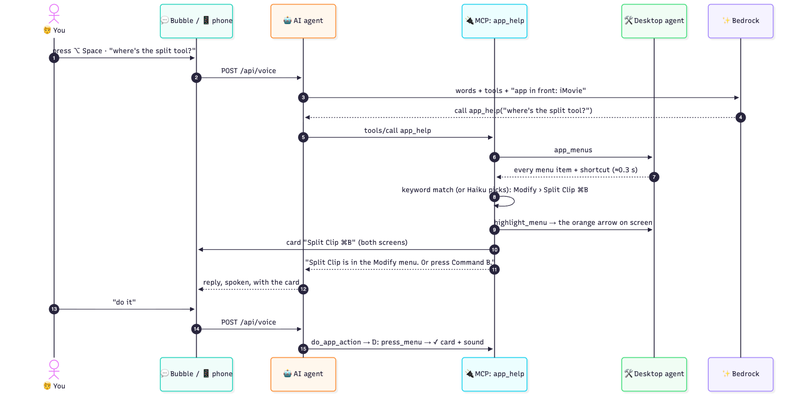
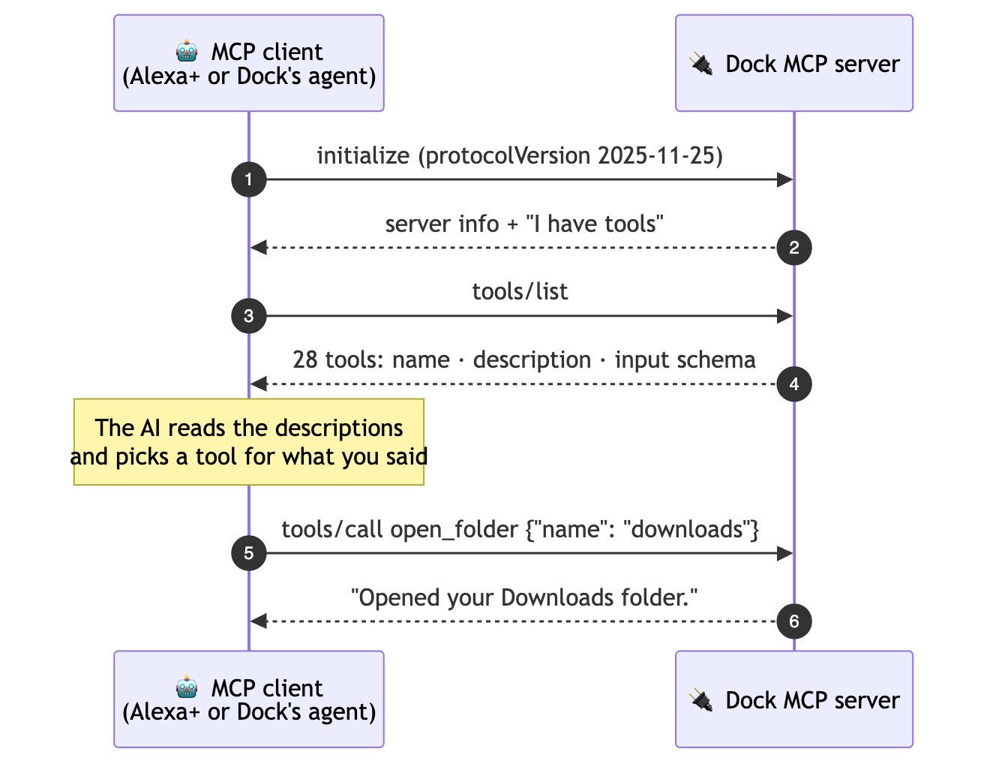
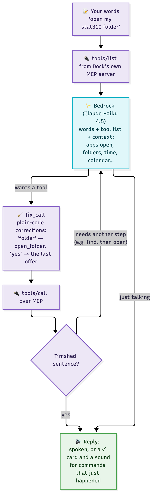
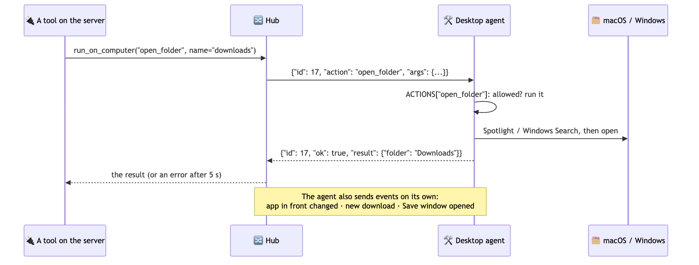
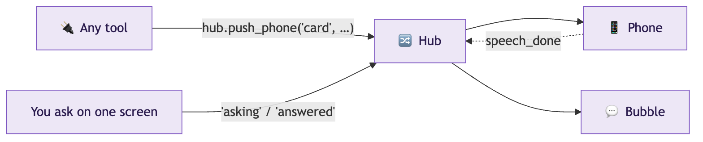

# How OneDock works

A guide for someone starting from zero. It covers what Dock is, what each piece does, how a request travels from your voice to your screen, what MCP is, and everything Dock can do.

> The diagrams are pictures in `docs/diagrams/`, made from the [Mermaid](https://mermaid.js.org) files next to them (`.mmd`). To change one, edit its `.mmd` and run:
> `npx -y @mermaid-js/mermaid-cli -i docs/diagrams/NAME.mmd -o docs/diagrams/NAME.png -b white -s 2`

---

## 1. Dock in one minute

Dock is a voice assistant for your desk: Alexa, but for your computer. Press **⌥ Space** (Alt+Space on Windows), or tap the face on the docked phone, and say what you want:

- *"Open my stat310 folder"* → the folder opens.
- *"Where's the split tool?"* (in iMovie) → Dock says "Modify menu, Split Clip, Command B", and an arrow points at it on screen. Say *"do it"* and Dock clicks it.
- *"Check this text"* → Dock suggests a fixed version of the text you selected, and you choose whether to use it.

It also handles your files, windows, writing, calendar and email, and has an optional focus timer. The full list is in [section 9](#9-everything-dock-can-do).

---

## 2. The big picture: a brain, hands and screens

Dock has three pieces:

| Piece | Think of it as | Where it runs | What it does |
|---|---|---|---|
| 🧠 **Dock server** (`server/`) | The **brain** | On your computer (it could also run in the cloud) | Understands what you said (with AI), decides what to do, remembers things, and tells the other pieces what to do |
| 🛠️ **Desktop agent** (`agent/`) | The **hands** | On your Mac or PC | Does the actual work on the computer: opens files, reads app menus, moves windows, draws the arrow. It has no AI of its own |
| 📱💬 **Screens** (`server/static/`) | The **face** | The phone in the dock, and a small bubble on the computer | Shows answers, cards, the timer and the face. Both show the same web page, so they always match |


**The one rule:** everything goes through the brain. The hands and the screens never talk to each other directly. Each one *calls in* to the server and keeps that line open. That's why Dock works on any Wi-Fi with no router setup.

**Where Alexa fits:** Amazon's Alexa+ can use outside services through a standard called **MCP** ([section 5](#5-mcp-from-scratch)). Dock's brain speaks MCP, so an Echo can become one more way to talk to Dock. No one in the hackathon can get Alexa+ access yet, so Dock has its own built-in assistant. It talks to the brain the same way Alexa+ would.

---

## 3. One request, step by step

You're in iMovie and say *"where's the split tool?"*:

1. **You talk.** You press ⌥ Space, and the microphone records until you stop talking.
2. **Your speech becomes text** on your computer, using a speech-to-text model called Whisper. Your voice never leaves the computer.
3. **The brain gets the text** and asks an AI model on Amazon Bedrock: *"Here's what the user said, and here are the 28 things Dock can do. Which one fits?"* The model answers: **app help**, with the question "where's the split tool?".
4. **The brain asks the hands** for iMovie's menus. The desktop agent reads every menu item and its shortcut in about 0.3 s.
5. **The brain finds the match:** *Modify › Split Clip, ⌘B*.
6. **The hands draw an orange arrow** on that menu item, and **both screens show a card**: "Split Clip ⌘B".
7. **Dock answers out loud:** "Split Clip is in the Modify menu. Or press Command B."
8. You say **"do it"**. The brain remembers what it just pointed at, the hands click it, and the clip splits.



Everything Dock does follows this pattern: **your words → the AI picks an action → the hands do it on the computer → the screens show it → Dock answers.**

---

## 4. Words you'll see

| Word | Plain meaning |
|---|---|
| **AI model / LLM** | A program that understands and writes text. Dock uses Claude Haiku 4.5 and Amazon Nova 2 Lite, through **Amazon Bedrock** (Amazon's service for running AI models) |
| **Tool** | One thing Dock can do, like `open_folder` or `app_help`. Each tool has a name, a description and a list of the inputs it needs |
| **MCP** | Model Context Protocol, a standard way for an AI assistant to find and use tools. It works like a USB plug for AI: any assistant that speaks MCP can use any MCP server's tools |
| **MCP server** | The side that *offers* tools. In Dock, that's the brain (at `/mcp`) |
| **MCP client** | The side that *uses* tools: Alexa+, Claude Desktop, or Dock's own assistant |
| **Agent** | This word means two different things here. The **AI agent** is the brain's assistant, which picks the tools. The **desktop agent** is the plain program on your computer that does the work |
| **WebSocket** | A connection that stays open, like a phone line, so the server can send something at any moment (a card, or a job for the computer) |
| **Accessibility API / UI Automation** | The features Mac and Windows offer for screen readers. They let a program read an app's menus and buttons, and press them. Dock uses them to "see" apps exactly |
| **Tunnel** | A free Cloudflare service that gives the brain a public web address, so your phone can reach it from anywhere |

---

## 5. MCP, from scratch

### What it is

An AI model on its own can only write text. To *do* things, it needs tools. **MCP** is the agreed way to offer tools to any AI assistant:

- The **server** says: "Here are my tools. Each has a name, a description written for the AI, and the inputs it needs."
- The **client** (the assistant) reads that list. When you ask for something, its AI picks a tool, and the client asks the server to run it.

The messages are small pieces of JSON. Dock uses the **Streamable HTTP** form of MCP, so each message is an ordinary web request: `POST /mcp`.



Three messages matter:
- `initialize`: hello, and which version of MCP to use.
- `tools/list`: what can you do?
- `tools/call`: do this one.

### How Dock's MCP server is built

It uses the official **MCP Python SDK** (`mcp==2.3.0`). Here is the core of it, from `server/dock_server/main.py`:

```python
from mcp.server import MCPServer

mcp = MCPServer("Dock", instructions="Dock is a desk assistant...")

computer.register(mcp, hub, savings)     # each file adds its tools
app_help.register(mcp, hub, state, savings)
...

app = mcp.streamable_http_app(stateless_http=True, json_response=True)  # serves /mcp
app.router.routes.append(Route("/api/voice", voice_endpoint, methods=["POST"]))   # Dock's own assistant
app.router.routes.append(WebSocketRoute("/ws/agent", hub.agent_endpoint))          # the hands
app.router.routes.append(WebSocketRoute("/ws/phone", hub.phone_endpoint))          # the screens
uvicorn.run(app, host="127.0.0.1", port=8000)
```

- **Stateless:** every call stands on its own, so restarting Dock never breaks a client.
- **Locked:** `/mcp` and `/api` need `Authorization: Bearer <token>`. The token is the secret saved in `.dock-token`.

### Making a tool

A tool is a normal Python function with `@mcp.tool()` above it. The SDK turns it into MCP for you:

```python
@mcp.tool()
async def open_folder(name: str) -> str:                       # ① name + typed inputs → what the tool needs
    """Open a folder on the user's computer, e.g. "downloads"   # ② the description the AI reads
    or "stat310". Dock searches the whole home folder."""
    result = await run_on_computer(hub, "open_folder", name=name)  # ③ ask the hands to do it
    await hub.push_phone("done", title=f"Opened {result['folder']}")  # ④ show a card on the screens
    return f"Opened your {result['folder']} folder."           # ⑤ what Dock says back
```

| Part | Becomes | Tip |
|---|---|---|
| Function name | The tool's name | Short and clear: `open_folder`, not `do_thing` |
| Type hints | The list of inputs (a JSON Schema) | `Literal["today", "week"]` gives the AI a fixed set of choices |
| Docstring | The description | **The most important part.** The AI chooses tools by reading this, so say *when* to use the tool and give example phrases |
| `return` | The reply | One or two short sentences, because it's spoken |
| `raise ToolError("…")` | An error the AI can explain | Say what to do next: "Select some text first" |

**Each tool has two outputs.** It *returns* short text for Dock to say, and it *sends* anything visual (cards, the arrow, checklists) to the screens through the server. Alexa+ can't draw on our phone, so the server does that itself.

**To add a tool:** write the function in a file in `server/dock_server/tools/`, then restart Dock. Also add a few phrases to the routing test, so you can check that the AI picks the new tool.

---

## 6. The brain's assistant (the AI agent)

This is Dock's built-in stand-in for Alexa+ (`server/dock_server/voice.py`). An AI agent is just a loop:

1. Give the AI your words and the tool list.
2. It picks a tool, and Dock runs it.
3. Show the AI the result.
4. Repeat until it has an answer.



What makes it work well:
- **It's a real MCP client.** It calls Dock's `/mcp` exactly the way Alexa+ would.
- **It gets a few facts with every request:** the app and window in front, the apps that are open, your folder and workspace names, the time, your next event, and whether any text is selected. That's how "open stat 3:10" still finds stat310, and how "how do I check my costs?" on the AWS console is understood as a question about that web page.
- **It asks when it isn't sure.** "Do the thing" gets a short question back instead of a guess.
- **Plain code fixes the AI's known mistakes.** This step is called `fix_call`. For example, "check this text" always means writing help, and "close everything except VS Code" always means hiding the other windows.
- **It remembers the last 6 exchanges**, so "do it", "open the second one" and "yes" work.
- **It's cheap and fast.** Claude Haiku 4.5 picks the tool in about 0.8 s. Dock's instructions and tool list are the same every time, so Bedrock caches them, and a request costs about $0.0015. Small jobs, like summaries, use the cheaper Nova 2 Lite.

The core of the loop, in about 10 lines (see `voice.answer`):

```python
async with Client(streamable_http_client(MCP_URL, http_client=http)) as mcp:
    tools = [to_bedrock_spec(t) for t in (await mcp.list_tools()).tools]
    messages = [{"role": "user", "content": [{"text": said}]}]
    for _ in range(6):                                    # at most 6 steps
        reply = bedrock.converse(messages, SYSTEM, tools)  # the AI picks
        if reply["stopReason"] != "tool_use":
            return text_of(reply)                          # it answered
        for call in tool_calls(reply):
            result = await mcp.call_tool(call["name"], call["input"])
            messages.append(tool_result(call, result))     # show it the result
```

---

## 7. The hands (the desktop agent)

The desktop agent is a plain Python program on your computer, with no AI. It connects to the server (at `/ws/agent`) and waits for jobs:



- **It only does what's on a fixed list of 47 actions** (`ACTIONS`), such as opening a folder, reading menus, moving a window or drawing the arrow. It refuses anything else. There's no way to run an arbitrary command, and it can't delete files.
- **It also reports things on its own:** when the app in front changes, a download finishes, or a Save window opens.
- **Mac:** it uses the Accessibility API (menus, buttons, text) and Spotlight (finding files). The arrow, the bubble and the menu-bar face are native Mac windows.
- **Windows:** it uses UI Automation, Windows Search, a tray icon and a WebView2 bubble ([WINDOWS-PORT.md](WINDOWS-PORT.md)). The action names and answers are the same as on the Mac, so the brain doesn't care which computer it's on.
- **Speech:** Whisper (`small.en`) turns your voice into text on the computer in about 0.5 s, for free and privately. Answers are spoken by macOS `say`, Windows' own voice, or the phone's browser voice.

---

## 8. How the screens stay in sync

The phone and the computer's bubble load **the same web page**. The bubble just adds `?screen=mac` to the address.



- Every screen gets every card, so they always show the same thing.
- Only the screen you asked on speaks. When it finishes, it tells the others, and their cards close too.
- **Reaching the phone from anywhere:** a free Cloudflare tunnel gives the brain a public HTTPS address. The phone app's files sit in a small S3 bucket, at a fixed link that always finds the brain's current address. So you only install the phone app once.

---

## 9. Everything Dock can do

**Talking to Dock**
- Press **⌥ Space** / **Alt+Space** once, click the face in the menu bar or tray, or tap the phone's face. Then talk or type.
- Your request sends when you stop talking. If you start typing, Dock stops listening. Esc closes the box.
- Commands that just happen ("open my downloads") get a ✓ and a short sound. Answers are spoken.
- Follow-ups work ("do it", "yes", "the second one"), and Dock asks back when a request is unclear.

**Files, apps and windows** (no AI cost)
- **Open folders and files:** "open my stat310 folder", "open the stat525 file I worked on yesterday", "what PDFs do I have in stat 310?".
- **Open apps:** "open VS Code". If the app isn't installed, Dock says so and opens nothing else.
- **Arrange windows:** "Chrome on the left and Notes on the right", "make this full screen", "move this to my other screen", "close everything except VS Code" (the other windows are hidden, never closed).
- **Workspaces:** "remember this as Study" saves your apps, documents, browser tabs, Finder folders and window positions. "Open my Study workspace" brings them all back.

**Help inside any app** (the main feature)
- **"Where is…?" / "how do I…?"** Dock reads the app's real menus, so the name and shortcut are exact. It answers out loud, points an arrow at the item on screen and shows a card.
- **Not in the menus?** Dock checks the window's buttons and links (this works on websites too, like the AWS console). If that fails, it takes one look at the screen with AI vision. Only after both does it offer a Google search, as a card you tap.
- **"Do it"** clicks what Dock just pointed at. A direct command ("split the screen", "knit the document") is done right away. Risky items, like Quit, are never clicked by voice.
- **Phone shortcut pad:** the phone shows buttons for the app in front, built from that app's menus. They change when you switch apps.

**Writing and reading**
- **Writing help:** select text anywhere and say "check this text", "fix the grammar", "make it more formal" or "translate to Spanish". Dock shows a suggestion, and nothing changes until you choose **Replace**, **Insert below**, **Change more** or ×. ⌘Z undoes a change.
- **Read and summarize:** "summarize this" (the selected text, a PDF, or a file Dock finds) or "read this to me".
- **Search:** "google how to cite APA" shows a **Search Google?** card. Nothing opens until you say yes.

**Downloads and saving**
- **Tidy Downloads:** say "help me tidy my downloads". Dock reads the start of each file, checks which site it came from and where you put similar files before, then suggests a folder for each one. Files it's unsure about stay where they are. Nothing moves until you agree, and "undo" puts files back.
- **"Where should this go?"** For a new download or an open Save window, Dock suggests a folder and can save there. It only suggests without being asked if you turn on folder suggestions.

**Calendar, notes and email** (after one "Sign in with Google")
- **Notes, to-dos and reminders:** "remind me to call Mom at 5", "I need to submit the form by Friday noon" (both go on your Google Calendar), "what's on my list?".
- **Your day:** "what's on today?", "what's next?", "get ready for stat class" (opens the meeting link and the matching folder).
- **Email:**
  - "What did I miss?" lists the important emails first and only counts the rest.
  - "Clean up my inbox" shows a checklist, and nothing moves until you say yes.
  - "Unsubscribe from Old Navy" unsubscribes you.
  - Dock can turn an email's deadline into a calendar to-do.
  - Dock never sends or replies to email.
- **Morning briefing:** "good morning" or "brief me" gives your calendar, email and list in one go.

**Focus mode** (optional)
- "Focus on stat310 homework for 50 minutes" (or until you stop) shows a countdown on the phone and in the menu bar. If you have a workspace with the same name, it opens.
- The phone camera pauses the timer when you walk away. Only "at desk / away" ever leaves the phone, never video. When you come back, Dock says "welcome back, you were in hw_03.Rmd".
- Dock nudges you gently when you drift off task (a dplyr tutorial counts as on-task). During breaks, it shows flashcards of the shortcuts you asked about. "How was my week?" gives a report.

**Your day in review**
- "What did I work on today?" gives a spoken recap of your apps and files. "How much time did Dock save me?" tells you the time saved.

**The 28 MCP tools behind all this**

| Group | Tools |
|---|---|
| 🗂️ Computer | `open_folder` `find_files` `open_file` `open_app` `arrange_windows` `workspace` |
| 🧭 Help inside apps | `app_help` `do_app_action` |
| 📥 Files into folders | `suggest_folders` `put_in_folder` `undo_last_action` `set_folder_suggestions` |
| 📖 Reading & your day | `read` `get_recap` |
| ✍️ Writing & search | `improve_writing` `apply_writing` `search_web` |
| 📅 Calendar & notes | `notes` `get_schedule` `get_ready` |
| ✉️ Email | `check_email` `clean_up_email` `add_email_todo` `unsubscribe_email` `get_briefing` |
| ⏱️ Focus | `start_focus_session` `control_focus` `focus_status` |

---

## 10. Safety and privacy

- **Dock asks before changing things.** Moving files, cleaning email, replacing your text and opening a search all show a card first and wait for your yes.
- **Only a fixed list of safe actions.** No deleting files, no shell commands, and no clicking Quit by voice.
- **What stays on your computer:**
  - your voice (Whisper runs locally);
  - your Google sign-in (in `server/.data/`, with your notes, email settings and focus log);
  - your workspaces and app time (in `~/.dock/`).

  The camera only ever sends "at desk / away". Google setup is in [GOOGLE-CALENDAR.md](GOOGLE-CALENDAR.md).
- **What goes to the AI, and only when needed:** the words you said, plus a little context. Dock takes a screenshot only when you ask for help and the menus don't have the answer.

---

## 11. Where things are in the repo

```text
OneDock/
├── server/                 🧠 the brain
│   ├── dock_server/
│   │   ├── main.py         wires everything: MCP, /api/voice, WebSockets, the page
│   │   ├── voice.py        🤖 the AI agent (MCP client + Bedrock loop + fix_call)
│   │   ├── hub.py          🔀 WebSockets: jobs to the computer, cards to the screens
│   │   ├── bedrock.py      ✨ calls to the AI models
│   │   ├── tools/          🔌 the MCP tools (computer, app_help, writing, focus…)
│   │   ├── mail.py · calendar_link.py · notes.py · briefing.py · google_account.py
│   │   └── tunnel.py · webapp.py   the phone's public address
│   └── static/             📱💬 the one web page for the phone and the bubble
├── agent/dock_agent/       🛠️ the hands (Mac); win/ = Windows
├── scripts/                install / start (.sh for Mac, .ps1 for Windows)
└── docs/                   this guide, Windows, Google setup, demo script, tests
```

**Real Alexa+, later:** register `/mcp` with Amazon's `alexa-ai` CLI. Alexa+ then becomes one more MCP client of the same 28 tools, with no changes to Dock.
